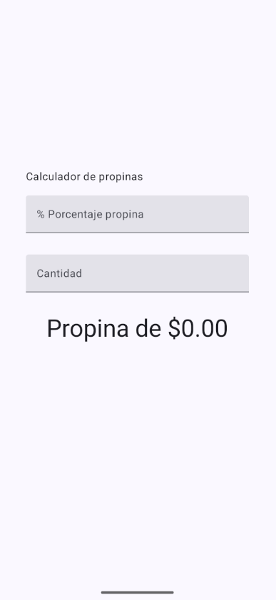
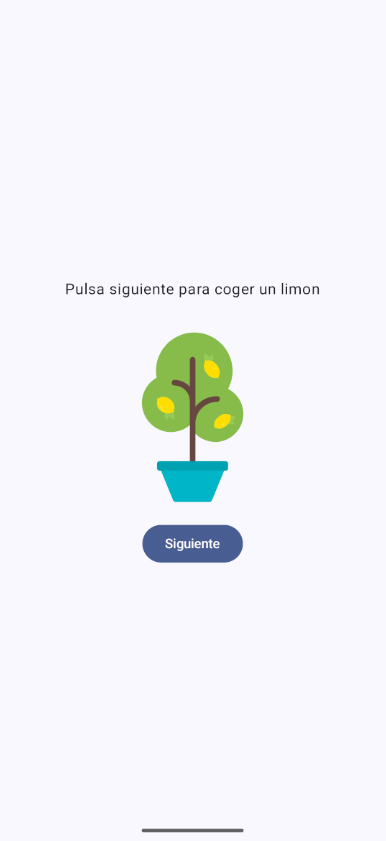
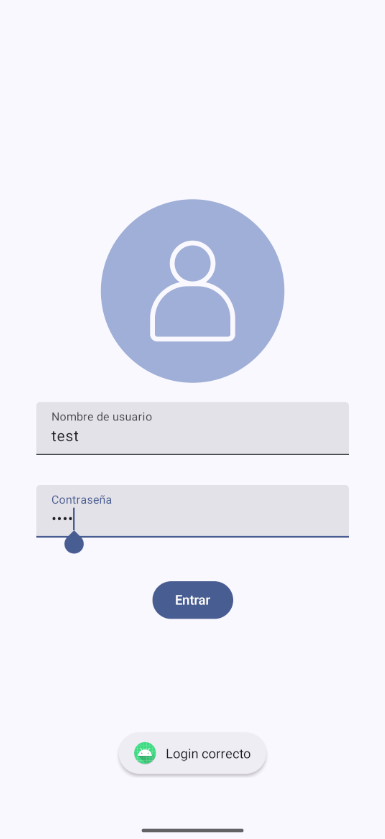
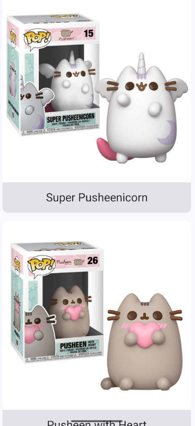
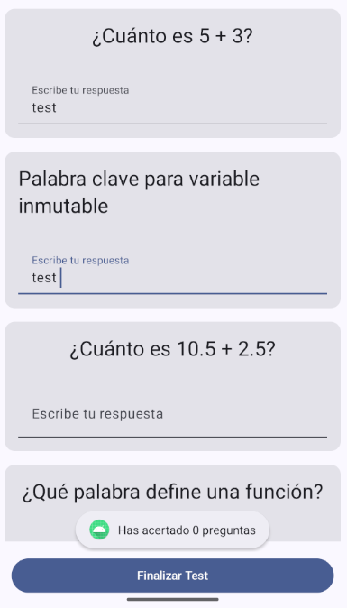
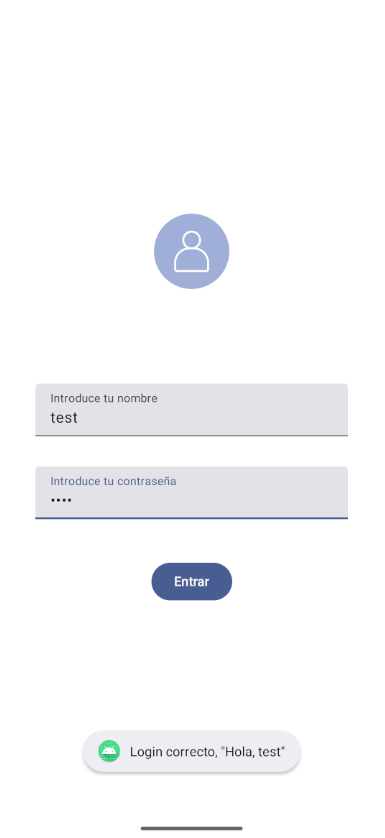

<div align="center">
  
</div>

<div align="center">
  <a href="https://github.com/evagr11/RepositorioInteractivo" target="_blank">
    
  </a>
  
  
  
  
</div>

<br>

<div align="center">
  <a href="https://git.io/typing-svg"></a>
</div>

# 🚀 Sobre el Proyecto

**Repositorio Interactivo** es una aplicación para Android que agrupa una colección de **mini-proyectos de ejemplo**, diseñados para explorar y demostrar diversas funcionalidades de desarrollo nativo moderno con **Kotlin y Jetpack Compose**. Cada mini-proyecto es una `Activity` independiente que se abre desde una pantalla principal, y cada uno practica algo distinto: campos de texto, estado, listas, validación de formularios o ViewModel.

✨ **Características principales:**

*   **🏠 Menú central**: Un carrusel horizontal (`LazyRow`) con una tarjeta por mini-proyecto. Cada tarjeta guarda la `Activity` de destino y la abre con un `Intent`, así que añadir un proyecto nuevo es añadir una línea a `MisProyectos`.
*   **💵 Calculadora de propinas**: Calcula la propina según la cantidad y el porcentaje (15 % si no se indica) y la muestra con el formato de moneda del dispositivo (`NumberFormat`).
*   **🍋 Limonada**: Cuatro pasos (coger el limón, exprimirlo, beberse la limonada y empezar de nuevo) que cambian de imagen y texto según el estado.
*   **🔒 Login**: Formulario con usuario y contraseña oculta que avisa con un `Toast` si falta algún campo.
*   **🖼️ Galería**: `LazyColumn` de tarjetas con imagen y nombre, cargadas desde recursos (`@DrawableRes`, `@StringRes`).
*   **📝 Test de 10 preguntas**: Usa una clase **genérica** `Pregunta<T>` para mezclar respuestas de tipo `Boolean`, `Int`, `Double` y `String`, y comprueba cada una con su tipo antes de dar la puntuación.
*   **🧠 Login con ViewModel**: El mismo login, pero con el estado en un `ViewModel` expuesto como `StateFlow` (`UIState`), que es el patrón recomendado por Google.

### 🖼️ Galería de mini-proyectos

<table align="center">
  <tr>
    <td align="center"><br><sub><b>Propinas</b></sub></td>
    <td align="center"><br><sub><b>Limonada</b></sub></td>
    <td align="center"><br><sub><b>Login</b></sub></td>
  </tr>
  <tr>
    <td align="center"><br><sub><b>Galería</b></sub></td>
    <td align="center"><br><sub><b>Test</b></sub></td>
    <td align="center"><br><sub><b>Login con ViewModel</b></sub></td>
  </tr>
</table>

# 🧠 Contexto del Proyecto

Este proyecto fue desarrollado como una iniciativa personal de aprendizaje y práctica. El objetivo principal era consolidar conocimientos en el desarrollo de aplicaciones para Android utilizando el paradigma moderno de UI declarativa con **Jetpack Compose** y las mejores prácticas de arquitectura recomendadas por Google, como el uso de **ViewModel** y **StateFlow** para desacoplar la lógica de la UI.

# 🛠️ Stack Tecnológico

| Tecnología | Descripción |
| :--- | :--- |
| **Lenguaje** | `Kotlin` |
| **Framework UI** | `Jetpack Compose` (con `Material 3`) |
| **Plataforma** | `Android SDK` (minSdk 24 · targetSdk 36) |
| **Arquitectura** | `MVVM` (Model-View-ViewModel) con `StateFlow` para la gestión de estado reactivo. |
| **Build System** | `Gradle` (con scripts en Kotlin `build.gradle.kts`) |
| **Dependencias Clave** | `androidx.activity:activity-compose`, `androidx.compose.material3`, `androidx.lifecycle:lifecycle-runtime-ktx` |

# 📂 Estructura del Proyecto

El repositorio está organizado siguiendo la estructura estándar de un proyecto de Android, con una clara separación de responsabilidades para cada mini-aplicación.

```bash
RepositorioInteractivo/
└── app/
    ├── build.gradle.kts     # Configuración de build del módulo app
    └── src/
        └── main/
            ├── AndroidManifest.xml  # Registro de Activities y permisos
            ├── java/com/evagr/proyectitosinteractivos/
            │   ├── data/            # Proyecto.kt y MisProyectos.kt (la lista del menú)
            │   ├── proyectos/
            │   │   ├── proyecto1/   # Calculadora de Propinas
            │   │   ├── proyecto2/   # Limonada
            │   │   ├── proyecto3/   # Login Básico
            │   │   ├── proyecto4/   # Galería de imágenes
            │   │   ├── proyecto5/   # Test con la clase genérica Pregunta<T>
            │   │   └── proyecto6/   # Login Avanzado con ViewModel
            │   └── ui/
            │       └── theme/       # Configuración del tema de Compose y Home.kt
            └── res/
                ├── drawable-nodpi/  # Imágenes de las tarjetas y de los proyectos
                ├── values/          # Strings, colores, temas XML
                └── ...
```

# 🚀 Cómo Utilizar el Proyecto

Para ejecutar este proyecto en tu entorno local, necesitarás **Android Studio** (versión recomendada: Hedgehog o posterior).

1.  **Clonar el repositorio:**
    ```bash
    git clone https://github.com/evagr11/RepositorioInteractivo.git
    ```

2.  **Abrir el proyecto en Android Studio:**
    *   En la pantalla de bienvenida de Android Studio, selecciona "**Open**".
    *   Navega hasta la carpeta `RepositorioInteractivo` que acabas de clonar y selecciónala.

3.  **Sincronizar Gradle:**
    *   Android Studio detectará automáticamente los archivos `build.gradle.kts` y comenzará a sincronizar el proyecto y a descargar las dependencias necesarias. Espera a que este proceso finalice.

4.  **Ejecutar la aplicación:**
    *   Selecciona un emulador de Android o conecta un dispositivo físico.
    *   Haz clic en el botón de **Run 'app'** (icono de play verde ▶️) en la barra de herramientas superior.

<div align="center">
    <p><em>Ejecuta la app para ver todos los proyectos interactivos.</em></p>
</div>

<br>

<div align="center">
  <p>Creado por <strong>Eva Gallardo</strong></p>
  <a href="https://github.com/evagr11" target="_blank">
    
  </a>
  <a href="https://www.linkedin.com/in/eva-gallardo-romero-830362349/" target="_blank">
    
  </a>
</div>

<div align="center">
  
</div>
